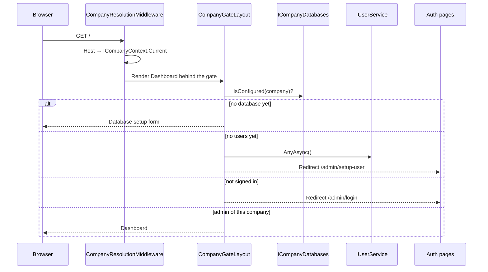

# Admin host

The **Admin host** ([`Projects/Admin`][1]) is a Blazor Server app that owns the
HTTP pipeline and the UI shell, and nothing else. Every capability it renders —
login, registration, the current user, service listings — comes from plugins.

```
        request (https://acme.example.com/)
                    │
        ┌───────────▼────────────┐
        │ ForwardedHeaders       │  X-Forwarded-Proto/Host/For
        ├────────────────────────┤
        │ CompanyResolution      │  sets ICompanyContext.Current
        ├────────────────────────┤
        │ UseCompanyHqPlugins()  │  Auth: RateLimiter → Authentication → Authorization
        ├────────────────────────┤
        │ Antiforgery            │
        ├────────────────────────┤
        │ Controllers / Razor    │  + CompanyHqPlugins.RouteAssemblies
        └────────────────────────┘
```

## Components

- **Pipeline**: [`Program.cs`][1]. It resolves the tenant, then hands the pipeline
  to the plugins, then maps endpoints. It names no plugin — see
  [Plugins](Plugins.md).
- **Tenant resolution**: [`CompanyResolutionMiddleware`][2] maps the request host
  to a company via `CompanyHq:Domains:{host}`, falling back to the only registered
  company when exactly one exists.
- **Shell**: [`MainLayout`][3] composes [`AdminChrome`][4] (header + [`NavMenu`][5])
  and [`Explorer`][6] (the Services sidebar). The Explorer reads
  [`IServiceCatalog`][7] and [`IServiceScaffolder`][8]; it never touches the
  filesystem and never writes the tenant.
- **Gate**: [`CompanyGateLayout`][9] decides what an arriving visitor gets.
- **Dashboard**: [`Dashboard.razor`][10] owns both `/` and `/admin`.

## Auth is a service, not host code

The host contains no login page, no registration page, no layout for them, and no
user logic. All four come from the Auth plugin:

| Concern | Owner |
|---|---|
| `/admin/login`, `/admin/setup-user` | [`Login.razor`][11], [`Register.razor`][12] |
| Authentication surface styling | [`AuthLayout`][13] |
| Credential handling | [`AuthController`][14], [`IAuthService`][15] |
| User records | [`IUserService`][16] |
| Cookie + policy middleware | [`AuthPlugin.ConfigureApplication`][17] |

The host's only involvement is `CompanyHqPlugins.RouteAssemblies`, which makes
those pages routable. See the [Auth service README](../../Projects/Services/Auth/README.md).

## Entry flow



1. [`CompanyResolutionMiddleware`][2] sets [`ICompanyContext.Current`][18] from the
   request host. No match with multiple companies leaves it `null`, and the gate
   renders "No company is configured for this domain."
2. [`CompanyGateLayout`][9] checks [`ICompanyDatabases.IsConfigured`][19] and shows
   the hosted-vs-external form when the company was created without the CLI.
3. With a database but no users, it redirects to `/admin/setup-user` —
   [`Register.razor`][12], an Auth page.
4. Unauthenticated visitors go to `/admin/login` — [`Login.razor`][11].
5. A signed-in user must hold the `Admin` role *and* a `company` claim matching
   the resolved company before [`Dashboard.razor`][10] renders.

Steps 3–5 all leave the host and land in the Auth plugin; the host contributes
the gate logic only.

## Known gaps

- **The single-company fallback in [`CompanyResolutionMiddleware`][2]** means any
  `Host` header resolves to the sole company. Convenient in development, wrong in
  production. It also hits the filesystem on every request without caching.
- **[`NavMenu`][5] links to routes that do not exist yet** (`pipeline`, `users`,
  `gallery`, `keys`, `skills`, `agents`, `help`, `settings`).
- **[`AdminChrome`][4] shows a hardcoded user** ("Olivia Martin") rather than
  [`ICurrentUser`][20].

[1]: ../../Projects/Admin/Program.cs
[2]: ../../Projects/Admin/Infrastructure/CompanyResolutionMiddleware.cs
[3]: ../../Projects/Admin/Components/Layout/MainLayout.razor
[4]: ../../Projects/Admin/Components/Layout/Components/AdminChrome.razor
[5]: ../../Projects/Admin/Components/Layout/Components/NavMenu.razor
[6]: ../../Projects/Admin/Components/Layout/Components/Explorer.razor
[7]: ../../Projects/Abstractions/Companies/IServiceCatalog.cs
[8]: ../../Projects/Abstractions/Companies/IServiceScaffolder.cs
[9]: ../../Projects/Admin/Components/Layout/CompanyGateLayout.razor
[10]: ../../Projects/Admin/Components/Pages/Companies/Dashboard.razor
[11]: ../../Projects/Services/Auth/Pages/Login.razor
[12]: ../../Projects/Services/Auth/Pages/Register.razor
[13]: ../../Projects/Services/Auth/Layout/AuthLayout.razor
[14]: ../../Projects/Services/Auth/Api/AuthController.cs
[15]: ../../Projects/Services/Auth/Services/AuthService.cs
[16]: ../../Projects/Abstractions/Users/IUserService.cs
[17]: ../../Projects/Services/Auth/AuthPlugin.cs
[18]: ../../Projects/Abstractions/Companies/ICompanyContext.cs
[19]: ../../Projects/Abstractions/Data/ICompanyDatabases.cs
[20]: ../../Projects/Abstractions/Users/ICurrentUser.cs
