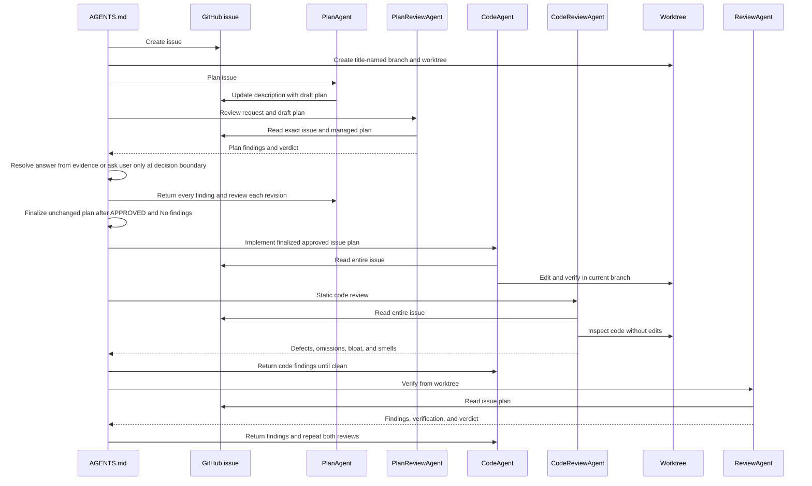
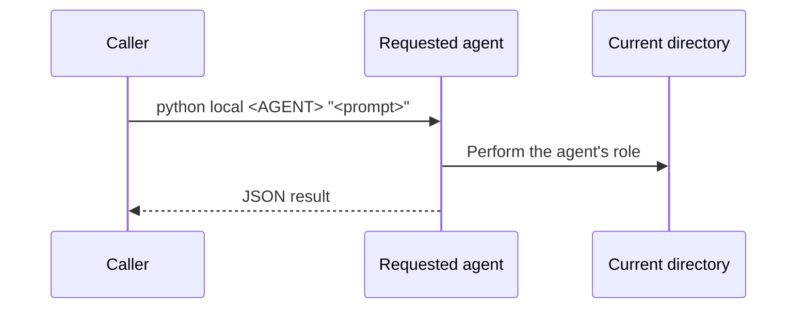

# CLI agents

## Decision

`AGENTS.md` is the **orchestrator** for headless CLI agents under `Agents/`. The governed workflow uses one GitHub issue and isolated worktree per implementation; every agent also accepts a direct local prompt when that workflow is not requested.

```text
AGENTS.md orchestrator
  ├─ GitHub CLI ──HTTPS──> issue description
  ├─ PlanAgent ─────────HTTPS──> managed draft plan in issue
  ├─ PlanReviewAgent ───HTTPS──> checks request against draft plan
  ├─ CodeAgent ─────────HTTPS──> reads issue and edits .worktrees/<work-name>
  ├─ CodeReviewAgent ───HTTPS──> statically reviews issue implementation
  └─ ReviewAgent ───────HTTPS──> verifies issue plan and worktree

Direct caller ──prompt──> requested agent ──operates──> current working directory
```

- **Orchestrator**: [`AGENTS.md`][1] creates the issue and worktree, relays questions and findings, and repeats implementation and review until safe to merge.
- **Agent launcher**: [`agent_launcher.py`][2] routes `python new <AGENT>`, `python reply <AGENT>`, and `python local <AGENT>` to a preset agent without changing its arguments or exit code.
- **Plan agent**: [`plan_agent.py`][3] investigates the repository and drafts a plan; GitHub mode persists it in managed issue markers while local mode returns it only in JSON.
- **Plan review agent**: [`plan_review_agent.py`][4] compares the exact request and decisions with the draft, validates repository claims, and blocks ambiguous plans before implementation.
- **Code agent**: [`code_agent.py`][5] implements either the approved plan from an entire GitHub issue or a direct prompt in the current working directory.
- **Code review agent**: [`code_review_agent.py`][6] performs a read-only static review against an issue or direct prompt for defects, omissions, bloat, and code smells.
- **Review agent**: [`review_agent.py`][7] reviews against an issue plan or direct prompt and runs required verification.
- **GitHub issue adapter**: [`github_issue.py`][8] owns issue reads, plan extraction, and idempotent plan replacement.

### Constraints

- **Explicit use only.** The orchestrator starts this workflow only when the user requests agents.
- **Preset values are frozen.** Model, effort, permission mode, and sandbox mode remain constants inside each wrapper.
- **No local plan files in the governed workflow.** GitHub workflow agents never create or consult `.plan`, `plans/`, or another plan file. Local agents may follow a task or plan location named in their prompt.
- **One shared work name.** The lowercase kebab-case issue title is used unchanged for the branch and `.worktrees/<work-name>` directory; the plan keeps the exact issue title as its main heading.
- **One isolated governed workspace.** GitHub workflow commands run in `.worktrees/<work-name>`; local agents operate in the caller's current working directory.
- **Headless contracts.** Wrappers return `{session_id, status, output, exit_code}` as JSON on stdout. Plan persistence is the only orchestration side effect.
- **Multi-turn sessions.** `QUESTIONS` responses resume through the wrapper's `reply` command with the same session ID and issue reference.
- **Orchestrator-owned technical decisions.** Before involving the user, the orchestrator investigates the issue, repository, current behavior, and established patterns and answers routine agent questions from evidence or the strongest behavior-preserving approach.
- **User decision boundary.** The user is asked only when evidence cannot establish a safe answer or a choice changes existing behavior, architecture, security, data, compatibility, or an approved product decision; the orchestrator provides options, a recommendation, and impact.
- **Finalized pre-implementation gate.** CodeAgent starts only when a fresh PlanReviewAgent returns `APPROVED` with `No findings.` and the reviewed managed plan remains unchanged. Every finding returns to PlanAgent, and every plan or requirement change invalidates the prior approval.
- **No agent-level timeout.** Wrappers do not impose subprocess deadlines.

### Implementation flow



1. The [orchestrator][1] creates the GitHub issue, derives one work name from its title, and uses that name for both branch and worktree.
2. The [launcher][2] dispatches `python new PlanAgent` to the [plan agent][3], which stores the draft through the [issue adapter][8].
3. The launcher dispatches `python new PlanReviewAgent` to the [plan review agent][4]. It answers questions itself after investigating evidence and asks the user only when a real decision boundary remains. Every finding returns to planning, and every revised plan receives a fresh review.
4. The exact managed plan is finalized only after a fresh review returns `APPROVED` with `No findings.` Any later plan or requirement change invalidates that approval. Only then does the launcher dispatch `python new CodeAgent` to the [code agent][5] from the issue worktree.
5. The launcher dispatches `python new CodeReviewAgent` to the [code review agent][6]. It statically traces the issue to the implementation and reports defects, omissions, bloat, and smells.
6. After the static review is clean, the launcher dispatches `python new ReviewAgent` to the [review agent][7] for implementation verification.
7. The orchestrator returns findings to the code agent session and starts both reviews again until verification passes.

### Local implementation flow



1. The caller runs `python local <AGENT> "<prompt>"` from the repository or directory the agent should inspect.
2. The [launcher][2] passes the prompt unchanged to the requested agent.
3. The agent performs its existing planning, review, implementation, or verification role without accessing a GitHub issue or requiring a dedicated branch or worktree.

[1]: ../../AGENTS.md
[2]: ../../Agents/agent_launcher.py
[3]: ../../Agents/PlanAgent/plan_agent.py
[4]: ../../Agents/PlanReviewAgent/plan_review_agent.py
[5]: ../../Agents/CodeAgent/code_agent.py
[6]: ../../Agents/CodeReviewAgent/code_review_agent.py
[7]: ../../Agents/ReviewAgent/review_agent.py
[8]: ../../Agents/github_issue.py
