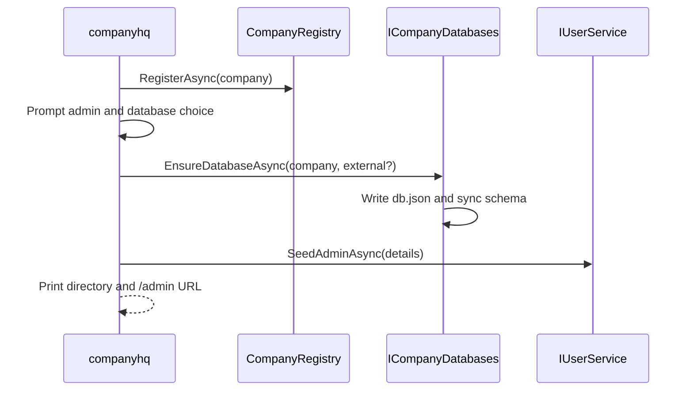

# Companies

## Decision

Everything CompanyHQ owns lives under `~/CompanyHQ/`. A company is a directory at
`Companies/{CompanyName}/`; the filesystem is the registry, and each company owns
its database credentials and service templates.

- **The CLI creates usable tenants.** [`companyhq`][1] accepts `--c <CompanyName>`
  and prompts for admin name, surname, email, contact number, password confirmation,
  and database placement. It registers the company, provisions or records the
  database, syncs the schema, and seeds the `Admin` user through
  [`CompanyCreation`][2]. `--root <path>` selects a development server root.
- **Remote mode relays the same flow.** `--sip <ip> --u <username>` opens an SSH
  shell and runs `companyhq --c <CompanyName>` remotely. Use `--p <password>`, omit
  it for a masked prompt, or pass `--conf <directory>` containing a private key.
- **Every company starts with `Services/`.** [`CompanyRegistry`][3] creates
  `Companies/{Name}/Services/`. [`IServiceScaffolder`][4] can only target the
  current [`ICompanyContext`][5] and generates a compilable plugin shaped like
  [`Projects/Services/Auth`][11]; it never activates a service. See
  [Service scaffolding](ServiceScaffolding.md).
- **Services scaffold from inside the company directory.**
  `companyhq service <ServiceName>` infers the company and server root from the
  working directory via [`CompanyLocator`][12], so `--c` and `--root` are needed
  only from outside. See [CLI](../Reference/Cli.md).
- **The company domain owns `/admin` and `/api`.** The dashboard is `/admin`, and
  the authenticated company API is `/api`. Caddy routes the domain to a process
  whose [`CompaniesPlugin`][6] binds every scope to one configured company.
- **CLI setup is primary; the dashboard gate is fallback.** [`CompanyGateLayout`][7]
  preserves the hosted/external database form for incomplete companies, then sends
  companies without users to `/admin/setup-user` and unauthenticated users to
  `/admin/login`.

## Local flow



1. [`CompanyCreation`][2] registers the company through [`ICompanyRegistry`][8].
2. It validates and re-prompts all admin fields, including email and matching masked passwords.
3. [`ICompanyDatabases`][9] provisions a managed database for option `1`, or records the option `2` connection string with `managed: false`.
4. The service sets [`ICompanyContext.Current`][5] in a new scope and calls [`IUserService.SeedAdminAsync`][10].
5. The CLI prints the company directory and `Open https://{your-domain}/admin`.

## Domain resolution

```json
{
  "CompanyHq": {
    "Company": "Acme",
    "ServerRoot": "C:/path/to/CompanyHQ/MockServer",
    "PluginRoot": "C:/path/to/CompanyHQ/MockServer"
  },
  "ConnectionStrings": {
    "CompanyHqServer": "Host=localhost;Database=postgres;Username=companyhq;Password=..."
  }
}
```

Each host process serves one company, fixed by `CompanyHq:Company`; the value is
required and the process fails to start without it. There is no `Host`-header
resolution and no single-company fallback — Caddy routes each domain to the right
process (see [Hosting](../Operations/Hosting.md)). `ServerRoot` owns mutable source,
`db.json`, and generated state. `PluginRoot` owns assemblies scanned at startup and
defaults to `ServerRoot` outside containers; images separate the two so runtime
mounts cannot shadow rebuilt plugins.

[1]: ../../Projects/Cli/Program.cs
[2]: ../../Projects/Services/Companies/Services/CompanyCreation.cs
[3]: ../../Projects/Services/Companies/Services/CompanyRegistry.cs
[4]: ../../Projects/Abstractions/Companies/IServiceScaffolder.cs
[5]: ../../Projects/Abstractions/Companies/ICompanyContext.cs
[6]: ../../Projects/Services/Companies/CompaniesPlugin.cs
[7]: ../../Projects/Admin/Components/Layout/CompanyGateLayout.razor
[8]: ../../Projects/Abstractions/Companies/ICompanyRegistry.cs
[9]: ../../Projects/Abstractions/Data/ICompanyDatabases.cs
[10]: ../../Projects/Abstractions/Users/IUserService.cs
[11]: ../../Projects/Services/Auth
[12]: ../../Projects/Services/Companies/Services/CompanyLocator.cs
