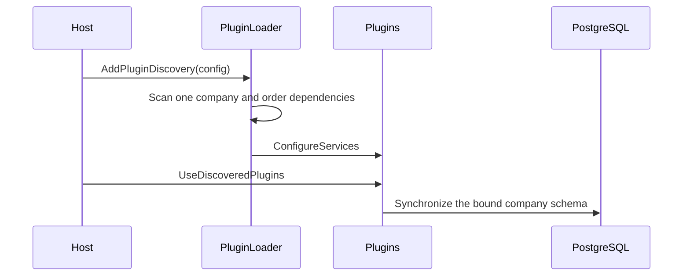

# Architecture

CompanyHQ is a **plugin-based platform**: each thin host discovers headless service plugins and consumes them through shared contracts.

```
┌──────────────────────────────┐   ┌──────────────────────────────┐
│ Admin host · HTTP / Blazor   │   │ CLI host · console / SSH     │
└──────────────┬───────────────┘   └──────────────┬───────────────┘
               └──────────────┬───────────────────┘
                              │ AddPluginDiscovery
               ┌──────────────▼───────────────────┐
               │ Infrastructure/PluginDiscovery   │
               │ scan · validate · order · load   │
               └──────────────┬───────────────────┘
                              │ ICompanyHqPlugin
               ┌──────────────▼───────────────────┐
               │ Companies · Postgress · Auth · … │
               │ headless services + optional UI  │
               └──────────────┬───────────────────┘
                              │ contracts
               ┌──────────────▼───────────────────┐
               │ Projects/Abstractions            │
               └──────────────────────────────────┘
```

## Components

- **Hosts**: [`Admin`][1] owns HTTP and the UI shell; [`Cli`][14] owns console and SSH workflows. Neither constructs plugins.
- **Discovery**: [`PluginLoader`][15] scans built-ins plus only the process-bound company's services, validates dependencies, registers services, runs plugin middleware, and exposes route assemblies through `IPluginCatalog`.
- **Contracts**: [`ICompanyHqPlugin`][2] defines identity, dependencies, DI registration, middleware, and route assemblies. Data consumers use [`BaseModel`][3], [`IRepository<T>`][4], [`IQueryService<T>`][5], and [`IModelContributor`][6].
- **Plugins**: [`CompaniesPlugin`][13] owns company context and paths, [`PostgressPlugin`][7] owns persistence, and [`AuthPlugin`][8] owns company-bound authentication. Company-scaffolded services use the same contract.

## Startup flow



1. [`PluginLoader`][15] requires `CompanyHq:Company`, discovers built-ins and that company's image-baked service assemblies, then dependency-orders active plugins.
2. Each [`ICompanyHqPlugin`][2] registers its headless services; [`CompaniesPlugin`][13] initializes every scoped company context from the process binding.
3. Web hosts call `UseDiscoveredPlugins`; route assemblies are passed to Razor endpoint and router discovery.
4. [`SchemaMigrator`][12] builds the plugin-contributed model and applies additive schema changes to the bound company's database.
5. Adding or enabling a company service requires rebuilding and recreating only that company's Admin image.

[1]: ../../Projects/Admin/Program.cs
[2]: ../../Projects/Abstractions/Plugins/ICompanyHqPlugin.cs
[3]: ../../Projects/Abstractions/Data/BaseModel.cs
[4]: ../../Projects/Abstractions/Data/IRepository.cs
[5]: ../../Projects/Abstractions/Data/IQueryService.cs
[6]: ../../Projects/Abstractions/Data/IModelContributor.cs
[7]: ../../Projects/Services/Postgress/PostgressPlugin.cs
[8]: ../../Projects/Services/Auth/AuthPlugin.cs
[12]: ../../Projects/Services/Postgress/Services/SchemaMigrator.cs
[13]: ../../Projects/Services/Companies/CompaniesPlugin.cs
[14]: ../../Projects/Cli/Program.cs
[15]: ../../Projects/Infrastructure/PluginDiscovery/PluginLoader.cs
