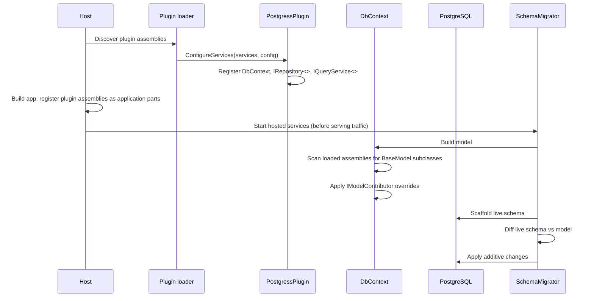

# Architecture

CompanyHQ is a **plugin-based platform**: a thin ASP.NET Core host loads **headless service plugins**, and every capability — persistence, auth, future features — ships as a plugin any host can consume.

```
┌────────────────────────────────────┐   ┌────────────────────────────┐
│  Host (Projects/Admin)             │   │  Host (Projects/Cli)       │
│  Blazor Server UI                  │   │  companyhq executable      │
└──────────┬─────────────────────────┘   └──────────┬─────────────────┘
           │      AddCompanyHqPlugins / UseCompanyHqPlugins
┌──────────▼──────────────────────────────────────────▼──────────────┐
│  Registry (Projects/Services/Plugins)                              │
│  CompanyHqPlugins.Default · RouteAssemblies                        │
└──────────┬─────────────────────────────────────────────────────────┘
           │ ConfigureServices · ConfigureApplication · RouteAssemblies
┌──────────▼─────────────────────────┐
│  Plugins (Projects/Services/*)     │
│  Companies · Postgress · Auth · …  │
│  Razor Class Libraries             │
└──────────┬─────────────────────────┘
           │ implements
┌──────────▼─────────────────────────┐
│  Contracts (Projects/Abstractions) │
│  ICompanyHqPlugin                  │
│  BaseModel · IRepository<T>        │
│  IQueryService<T> · IModelContributor │
└────────────────────────────────────┘
```

## Components

- **Host**: [`Projects/Admin`][1] is a Blazor Server app. It owns the HTTP pipeline and UI shell, and consumes services only through the contracts in `Abstractions` — see [Admin host](AdminHost.md). The [`companyhq` CLI][14] ([`Projects/Cli`][14]) is a second, headless consumer of the same plugins, used to create companies and scaffold services (see [CLI](../Reference/Cli.md)).

- **Registry**: [`Projects/Services/Plugins`][15] is the headless plugin composition service holding the one plugin list both hosts read. It is the only project that names plugins; hosts reference it and call `AddCompanyHqPlugins` / `UseCompanyHqPlugins`. Discovery-based loading is still not built — see [Plugins](Plugins.md).

- **Contracts**: [`ICompanyHqPlugin`][2] is the plugin entry point: identity, `ConfigureServices`, `ConfigureApplication` for the middleware a plugin's services require, and `RouteAssemblies` for its routable pages. The data contracts — [`BaseModel`][3], [`IRepository<T>`][4], [`IQueryService<T>`][5], [`IModelContributor`][6] — are the only persistence surface consumers ever see. Schema-only intent: no runtime logic beyond defaults.

- **Plugins**: one project per service under `Projects/Services/`, each a Razor Class Library implementing [`ICompanyHqPlugin`][2]. Current: [`PostgressPlugin`][7] (persistence provider, see [Postgress service README](../../Projects/Services/Postgress/README.md)), [`CompaniesPlugin`][13] (company creation, registry, current-company context, and service scaffolding — see [Companies](Companies.md)), and [`AuthPlugin`][8] (company-bound login and authorization, see [Auth](../../Projects/Services/Auth/README.md)). A plugin registers its own services in `ConfigureServices`; the host never wires plugin internals.

## Startup flow



1. The host calls `AddCompanyHqPlugins`, which invokes [`ICompanyHqPlugin.ConfigureServices`][2] on each entry of [`CompanyHqPlugins.Default`][15] in order (discovery not yet built; the contract, registry, and plugins are). Web hosts then call `UseCompanyHqPlugins` after tenant resolution so each plugin can add its own middleware.
2. [`PostgressPlugin`][7] reads the `CompanyHq` connection string and registers [`DbContext`][9], [`PostgressRepositories<T>`][10], and [`PostgressQueries<T>`][11].
3. Each plugin's [`RouteAssemblies`][2] are passed to the Blazor router and `AddAdditionalAssemblies` so its Razor pages are inherited by the host — see [Plugins](Plugins.md).
4. Before the host serves traffic, the [`SchemaMigrator`][12] hosted service builds the model — [`DbContext`][9] scans all loaded assemblies for concrete [`BaseModel`][3] subclasses and applies every registered [`IModelContributor`][6] — then diffs the live database against it and applies additive schema changes (see [Data access](DataAccess.md)).
5. There is no hot reload: adding or enabling a plugin recycles the app, and startup discovery plus schema sync pick up the new models.

[1]: ../../Projects/Admin/Program.cs
[2]: ../../Projects/Abstractions/ICompanyHqPlugin.cs
[3]: ../../Projects/Abstractions/Data/BaseModel.cs
[4]: ../../Projects/Abstractions/Data/IRepository.cs
[5]: ../../Projects/Abstractions/Data/IQueryService.cs
[6]: ../../Projects/Abstractions/Data/IModelContributor.cs
[7]: ../../Projects/Services/Postgress/PostgressPlugin.cs
[8]: ../../Projects/Services/Auth/AuthPlugin.cs
[9]: ../../Projects/Services/Postgress/DbContext.cs
[10]: ../../Projects/Services/Postgress/Services/PostgressRepositories.cs
[11]: ../../Projects/Services/Postgress/Services/PostgressQueries.cs
[12]: ../../Projects/Services/Postgress/Services/SchemaMigrator.cs
[13]: ../../Projects/Services/Companies/CompaniesPlugin.cs
[14]: ../../Projects/Cli/Program.cs
[15]: ../../Projects/Services/Plugins/CompanyHqPlugins.cs
