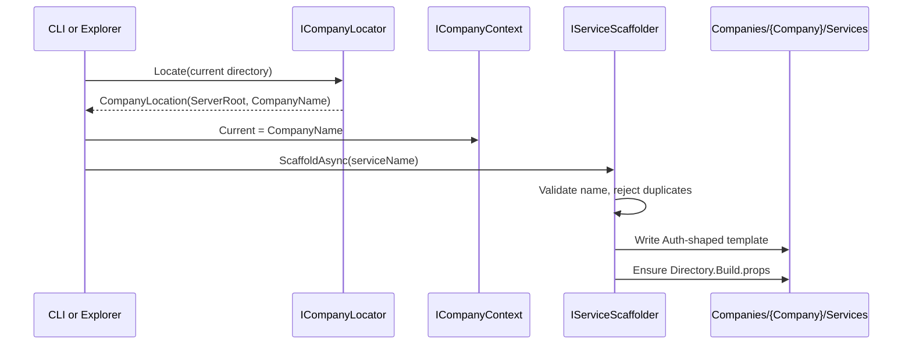

# Service scaffolding

## Decision

A scaffolded service is a **compilable plugin laid out exactly like
[`Projects/Services/Auth`][1]**, so a generated service and a first-party one are
the same shape and a developer only learns one structure.

- **The template is the Auth layout.** [`ServiceTemplate`][2] writes `{Name}.csproj`,
  `{Name}Plugin.cs`, `_Imports.razor`, `README.md`, and the `Api/`, `Components/`,
  `Dtos/`, `Layout/`, `Models/`, `Pages/`, `Services/`, `Settings/` directories.
  `Dtos/`, `Layout/`, and `Models/` are created empty; the rest get a starter file.
- **The generated plugin compiles and implements [`ICompanyHqPlugin`][3]** with a
  headless `{Name}Service`, a `{Name}Controller`, a routable `Pages/Index.razor`,
  and `RootNamespace` set to `CompanyHQ.Services.{Name}`.
- **Scaffolding is company-scoped.** [`ServiceScaffolder`][4] targets the ambient
  [`ICompanyContext.Current`][5] and throws when none is set. There is no
  company parameter, so a caller cannot write into the wrong tenant by accident.
- **Listing is a service too.** [`IServiceCatalog`][6] is the only way to enumerate
  a company's services. UI never walks the filesystem.
- **`Settings/service.json` starts `enabled: false`.** Nothing reads it yet; it is
  the intended activation switch once the plugin loader exists.

### The Abstractions reference

Generated projects reference Abstractions through a `CompanyHqAbstractionsPath`
property in a `Directory.Build.props` written once per company at
`Companies/{Company}/Services/Directory.Build.props`. Two rules follow:

- **Fix the path in one place.** A second scaffold never overwrites an edited file.
- **The default assumes the MockServer geometry**
  (`../../../../../Projects/Abstractions/Abstractions.csproj`, resolved relative
  to the `.csproj`, which sits one level below the props file). Deployments outside
  the repo must set `CompanyHq:AbstractionsPath`.

## Flow

1. The CLI resolves the company from the working directory via
   [`CompanyLocator`][7]; the Admin explorer skips this because
   [`CompanyResolutionMiddleware`][8] already set the tenant from the request host.
2. The caller sets [`ICompanyContext.Current`][5] on a scope.
3. [`ServiceScaffolder`][4] validates the name through [`NameValidator`][9] and
   throws when the directory already exists.
4. It writes the template, then writes `Directory.Build.props` only if absent.
5. [`IServiceCatalog`][6] picks the new directory up on the next read — the
   filesystem is the catalogue, so there is no index to keep in sync.

## Directory resolution

[`CompanyLocator`][7] walks up from a directory looking for a folder whose parent
is named `Companies`; the server root is that folder's grandparent.

| Working directory | Company | Server root |
|---|---|---|
| `MockServer/Companies/Acme` | `Acme` | `MockServer` |
| `MockServer/Companies/Acme/Services/Billing` | `Acme` | `MockServer` |
| `MockServer/Companies` | *none* | — |
| Anywhere else | *none* | — |

The `Companies` folder itself resolves to nothing on purpose: scaffolding from
there must fail loudly rather than silently pick a neighbouring tenant.

[1]: ../../Projects/Services/Auth
[2]: ../../Projects/Services/Companies/Services/ServiceTemplate.cs
[3]: ../../Projects/Abstractions/ICompanyHqPlugin.cs
[4]: ../../Projects/Services/Companies/Services/ServiceScaffolder.cs
[5]: ../../Projects/Abstractions/Companies/ICompanyContext.cs
[6]: ../../Projects/Abstractions/Companies/IServiceCatalog.cs
[7]: ../../Projects/Services/Companies/Services/CompanyLocator.cs
[8]: ../../Projects/Admin/Infrastructure/CompanyResolutionMiddleware.cs
[9]: ../../Projects/Services/Companies/Services/NameValidator.cs
