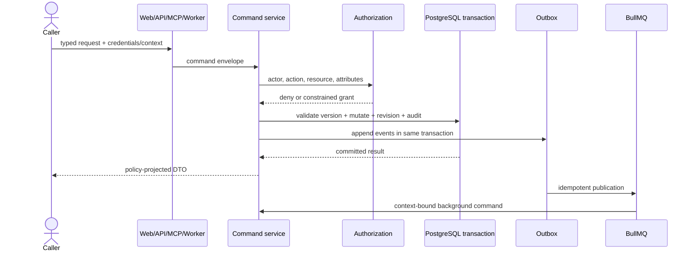

# Data flow

> **Document status:** Target V1 architecture contract.

Reads use query services that compile authorized filters before SQL and project registered DTOs before serialization. Writes never expose database records as responses. Relationship expansion repeats access checks and enforces depth/count limits.

Redis caches only reconstructible data. Cache invalidation keys include installation and configuration revision. Outbox publication uses a unique event ID; consumers record idempotency before external effects.
