# Architecture and workflow diagrams

> **Document status:** Target V1 visual contracts.

## Company installation architecture

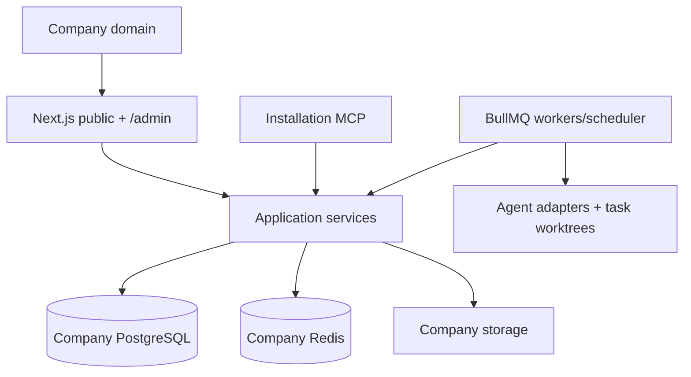

## Domain and admin routing

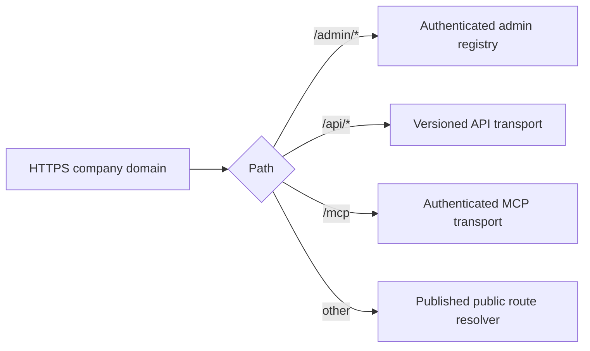

## Company directory layout

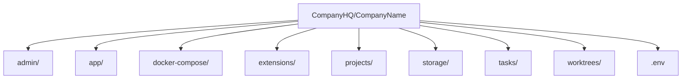

## Provisioning

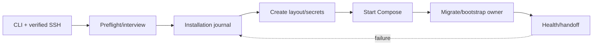

## Authentication and permissions

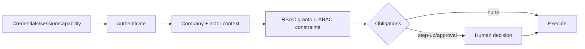

## CMS schema flow

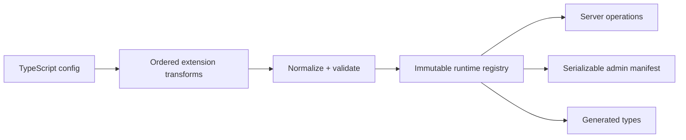

## DTO projection

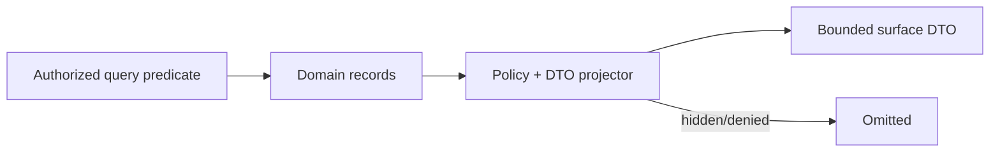

## Admin override fallback

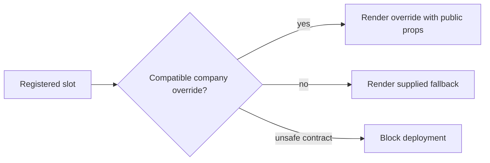

## Content mutation

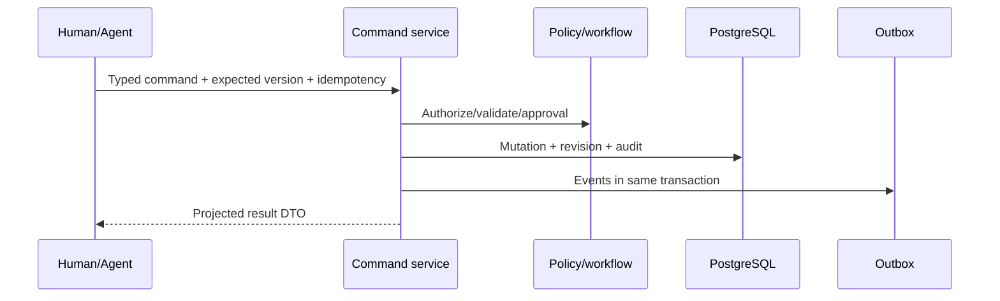

## Draft and publishing flow

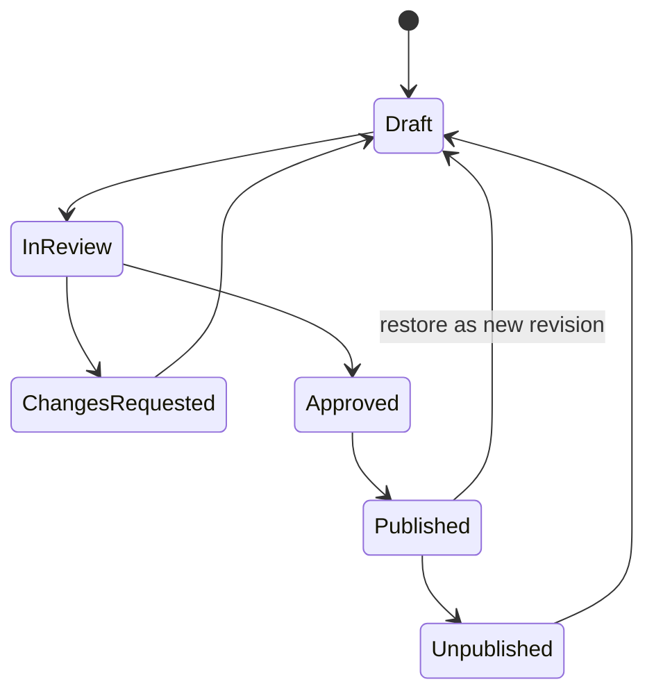

## Brain dump to task

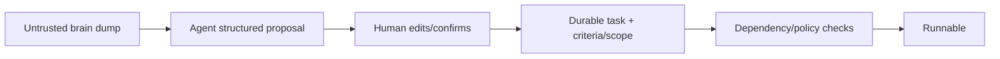

## BullMQ execution

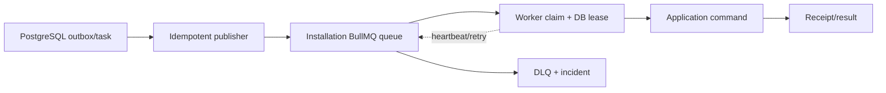

## Agent connection

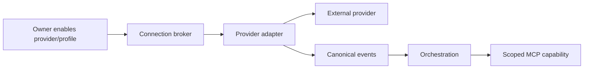

## Agent Chat

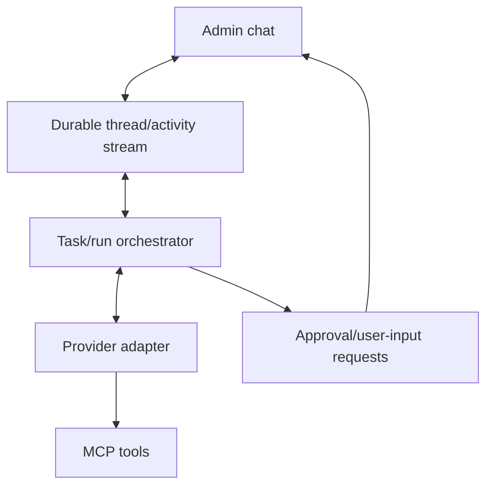

## Hermes profiles

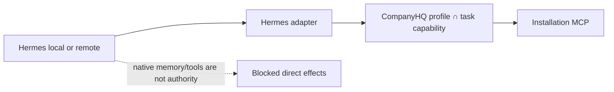

## MCP authentication

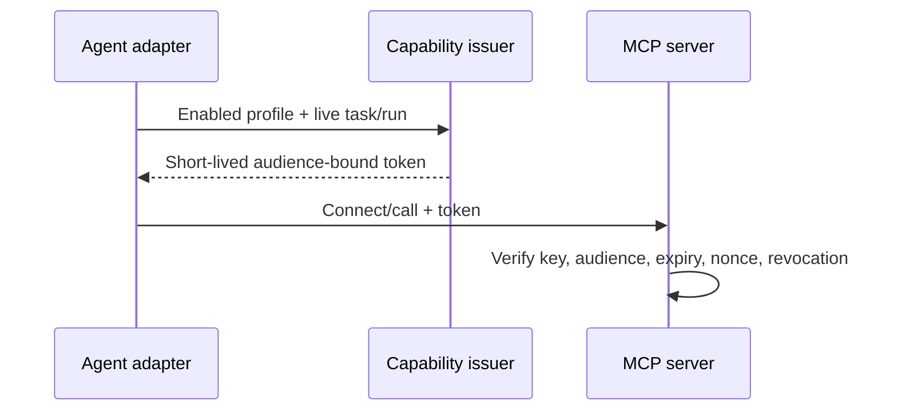

## MCP authorization

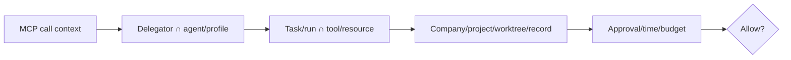

## MCP tool execution

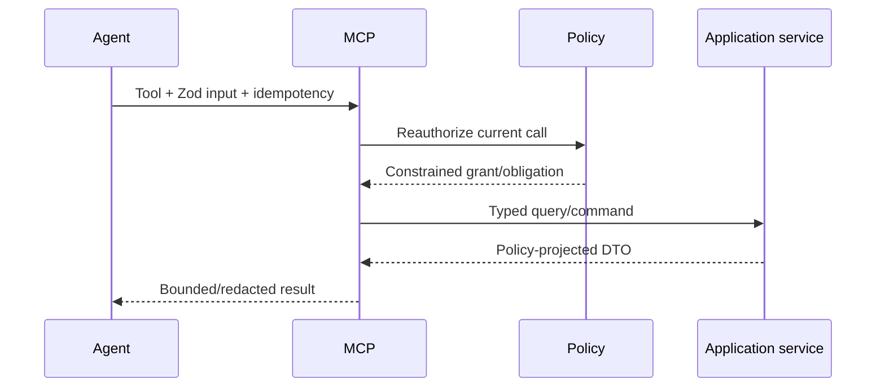

## Project source control

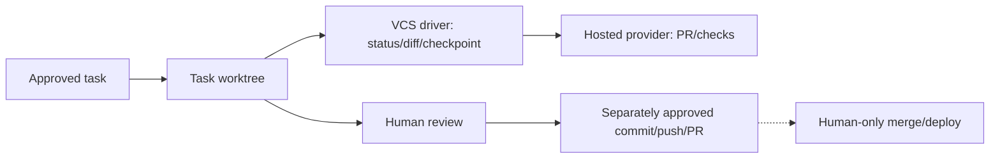

## Worktree lifecycle

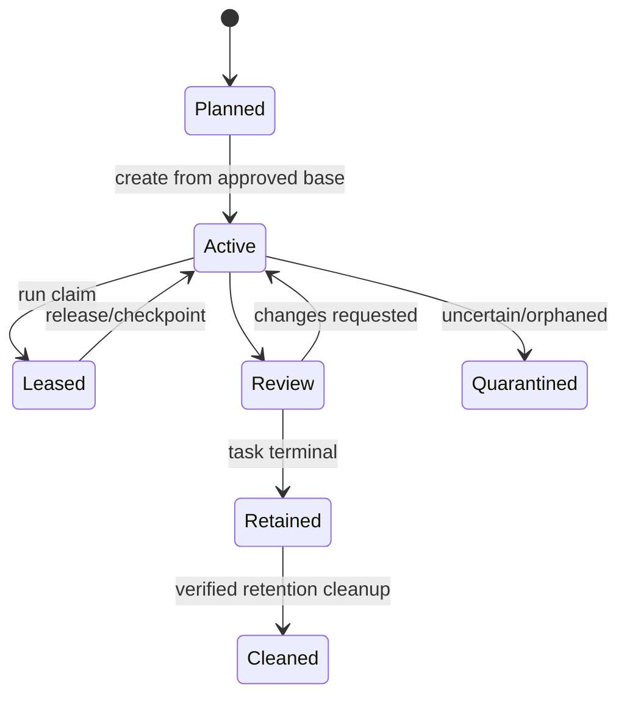

## Agent recovery

```mermaid
flowchart LR
  F["Crash/disconnect"] --> R["Reconcile DB lease + BullMQ + provider + worktree"] --> U{"Outcome known?"}
  U -->|"yes, compatible"| S["Resume/checkpoint"]
  U -->|"no"| Q["Quarantine/wait for human"]
  S --> N["New fenced attempt"]
```

## Audit flow

```mermaid
flowchart LR
  C["Authorized command"] --> T["PostgreSQL transaction"]
  T --> M["Business mutation"]
  T --> R["Revision"]
  T --> A["Append-only audit"]
  T --> O["Outbox"]
  O --> X["Jobs/integrations"]
```

## Development and production separation

```mermaid
flowchart TB
  C["Same contracts/images/topology"] --> D["Development: local secrets, fixtures, mock providers"]
  C --> P["Production: pinned images, TLS, external backups, restricted egress"]
  D -. "no data/credentials promotion" .- P
```
