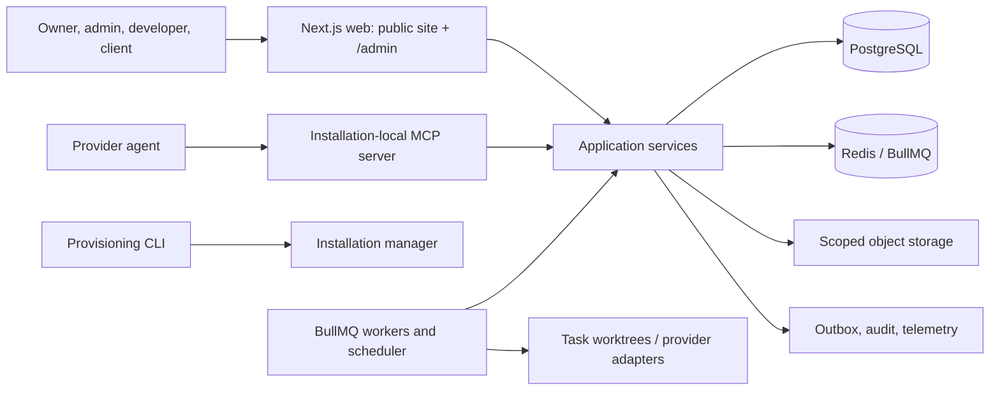

# Architecture overview

> **Document status:** Target V1 architecture contract. No runtime is implemented.

CompanyHQ is one independently deployed CMS per company. An installation has one Next.js application serving the public site and `/admin`, separate workers and scheduler, its own PostgreSQL database, Redis namespace, queues, storage, secrets, projects, worktrees, MCP server, logs, backups, and audit chain. There is no central CompanyHQ service and no UI for switching companies.

## Non-negotiable boundaries

- Web, MCP, CLI, worker, scheduler, and webhook ingress all construct the same validated company and actor context.
- Mutations enter typed application commands. Authorization, validation, workflow, version, audit, idempotency, and concurrency are not caller responsibilities.
- Agents never import repositories, connect to PostgreSQL/Redis, merge changes, approve their own actions, or deploy.
- Configuration is compiled into an immutable runtime registry; plugins transform configuration before final validation, not after startup.
- PostgreSQL is authoritative for business state. Redis is disposable coordination/queue infrastructure, never the only record of an approval, task, revision, or audit event.
- External effects are emitted from a transactional outbox and processed idempotently.

## Runtime applications

| Application | Owns | Must not own |
| --- | --- | --- |
| `apps/web` | Public routes, admin route groups, route handlers, sessions, rendering | Queue polling, provider processes, direct SQL |
| `apps/worker` | BullMQ consumers, agent runs, media/index/webhook jobs | Public HTTP, policy bypass |
| `apps/scheduler` | Reconcile schedules into repeatable jobs | Business mutation implementation |
| `apps/cli` | SSH connection profiles, install/upgrade/backup operations | Company runtime credentials beyond bootstrap |

See [runtime boundaries](runtime-boundaries.md), [company isolation](company-isolation.md), and [data flow](data-flow.md).
