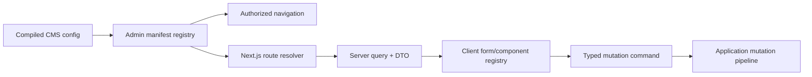

# Admin routing

> **Document status:** Target V1 architecture contract.

The Next.js application owns `/admin`. A server-generated admin manifest registers dashboard views, collection/global list and detail routes, account/auth routes, settings, projects, tasks, agents, custom pages, navigation groups, actions, and component slots.

Routes use stable registered keys, never arbitrary filesystem lookup. The route resolver authenticates and authorizes before loading a view. Navigation is derived from the same policy but is not enforcement. Server components load policy-projected DTOs and serializable manifests; client components handle interaction and submit commands to route handlers/server actions that reauthenticate.

List pages own bounded filtering, sorting, cursor pagination, bulk actions, saved views, and column policy. Detail pages own form state, workflow/revision panels, optimistic version tokens, validation errors, and approval state. Auth pages use a separate minimal layout and never load CMS data before authentication.
