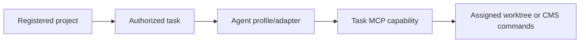
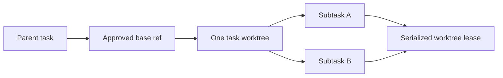
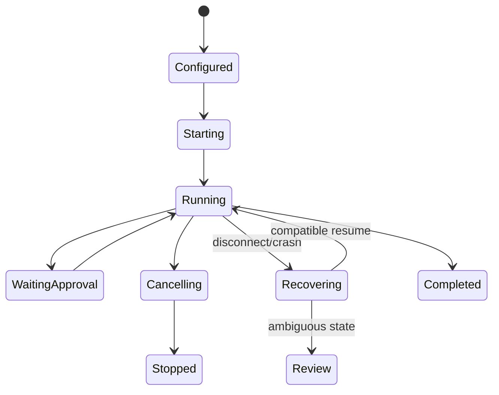
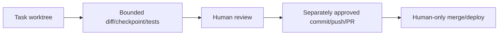
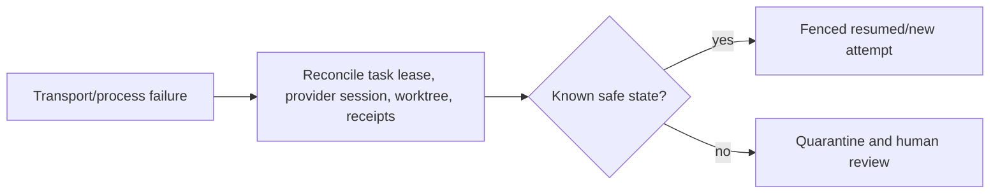

# T3 Code architecture and source-control study

> **Document status:** Reference finding from `.repos/t3code`; not CompanyHQ implementation. Inspected 2026-07-10.

## Repository map

T3 Code is an MIT-licensed TypeScript/ESM pnpm monorepo. Root `package.json` pins pnpm 11.10 and Node 24.13, uses Vite+ for recursive build/typecheck/lint/test/format, and dispatches development through `scripts/dev-runner.ts`. Its applications are `apps/server` (Node/WebSocket orchestration server with `src/bin.ts` development and `dist/bin.mjs` production entry), `apps/web` (React 19/Vite/TanStack Router client), `apps/desktop` (Electron), `apps/mobile` (Expo), and `apps/marketing`. Shared boundaries live in `packages/contracts`, `packages/client-runtime`, `packages/shared`, provider protocol packages, SSH, and Tailscale packages. The repository identifies itself as early work in progress. No Docker/Compose deployment contract was found in the inspected root configuration; distribution scripts focus on server/desktop artifacts.

| Area | Important modules and responsibility |
| --- | --- |
| Contracts | `packages/contracts/src/orchestration.ts`, `git.ts`, `vcs.ts`, `sourceControl.ts`, `project.ts`, and `providerRuntime.ts` define schema-validated network/domain messages. |
| Client runtime | `packages/client-runtime/src/rpc`, `connection`, `authorization`, `operations`, and `state` own transport, connection profiles/supervision, auth tokens, commands, cached projections, and reducers. |
| Server orchestration | `apps/server/src/orchestration` decides commands, appends events, drives provider commands, ingests runtime events, publishes receipts, and builds projections. |
| Persistence | `apps/server/src/persistence` uses SQLite migrations/repositories for events, receipts, auth sessions, provider runtime, projects, threads, turns, messages, approvals, and checkpoints. |
| Providers | `apps/server/src/provider` contains canonical services, built-in drivers/catalog, adapter layers, ACP support, provider instance state, maintenance, status, directory, and reaper. |
| VCS/source control | `apps/server/src/vcs`, `git`, `sourceControl`, `checkpointing`, and `review` separate local VCS, hosted providers, checkpoint state, and review. |
| Workspace/process | `apps/server/src/workspace`, `process`, `terminal`, and `project` own bounded workspace access, process lifecycle, terminal sessions, and project registration. |
| Web UI | `apps/web/src/components/chat`, `DiffPanel.tsx`, `GitActionsControl.tsx`, `PullRequestThreadDialog.tsx`, and settings pages present session, approval, diff, source, provider, and connection state. |
| Tests | Tests are colocated across contracts, server layers/adapters, client reducers, connection supervision, and UI logic; provider adapter suites are particularly extensive. |

The runtime path is browser/client → typed WebSocket contract → server orchestration → provider adapter/process. `packages/contracts/src/orchestration.ts` defines commands, events, projects, sessions, turns, approvals, checkpoints, and runtime modes. `apps/server/src/orchestration/Layers/OrchestrationEngine.ts` decides commands, appends events, and reconciles projections. `apps/server/src/persistence/Layers/OrchestrationEventStore.ts` persists and pages an append-only SQLite event stream. Projection modules materialize threads, turns, messages, activities, approvals, and checkpoints.

Provider drivers are registered behind common contracts under `apps/server/src/provider`. Implementations exist for Codex, Claude, Cursor, Grok, and OpenCode, although older provider documentation still says only Codex is implemented. Persisted provider-thread bindings and an inactivity reaper support session recovery and cleanup. Provider-native identifiers remain behind the adapter.

### Agent/runtime execution flow

1. Client commands conform to `packages/contracts/src/orchestration.ts` and cross the typed RPC/WebSocket boundary.
2. `apps/server/src/orchestration/Layers/OrchestrationEngine.ts` loads the read model, checks command invariants/decides events, appends each event, updates projections, and records deterministic completion receipts.
3. `ProviderCommandReactor.ts` translates relevant orchestration events into provider-service actions; `ProviderRuntimeIngestion.ts` normalizes provider runtime events back into orchestration commands/events.
4. `RuntimeReceiptBus.ts` correlates asynchronous provider completion. Queue-backed workers based on the shared `DrainableWorker` pattern preserve order and support graceful drain inside one server process.
5. `apps/server/src/provider/Layers/ProviderService.ts` selects the configured provider instance/driver, while `ProviderSessionDirectory.ts` persists thread bindings. `ProviderSessionReaper.ts` skips active turns and stops inactive sessions after a configured threshold.
6. Pending approvals and user-input requests are projections rendered by `apps/web/src/components/chat/ComposerPendingApprovalPanel.tsx` and `ComposerPendingUserInputPanel.tsx`; adapter callbacks translate the decision back to provider-native semantics.

The architecture gives clean event normalization and UI recovery, but its process-local queues and SQLite state do not provide CompanyHQ's cross-process leases, DLQ, durable schedule reconciliation, or independent-company enforcement.

Source control is split into VCS operations and hosted-provider operations. `packages/contracts/src/vcs.ts` models Git/Jujutsu capabilities and process failures; `packages/contracts/src/git.ts` models status, refs, worktrees, commit/push/PR actions, progress, timeouts, and output limits. `apps/server/src/git/GitWorkflowService.ts` gates repository operations and delegates worktree/ref operations to drivers. `apps/server/src/sourceControl` provides GitHub, GitLab, Bitbucket, and Azure DevOps adapters. `apps/server/src/checkpointing/CheckpointStore.ts` captures hidden-ref workspace checkpoints and restores/diffs them separately from provider conversation rollback.

### Source-control execution flow

1. Project/VCS contracts identify a working directory and requested capability. `VcsProvisioningService.ts` resolves a supported driver (Git by default) and rejects unknown kinds.
2. `GitWorkflowService.ts` first detects/validates the repository, then delegates status, pull, ref, fetch, worktree, or action operations.
3. `GitVcsDriverCore.ts` runs Git with a default 30-second timeout, bounded stdout/stderr, output truncation, structured errors, and tracing; longer commit flows have explicit limits. It caches expensive remote-status refreshes briefly.
4. `GitManager.ts` coordinates higher-level commit/push/pull-request sequences and progress events. It handles existing/open/cross-repository pull requests and generated branch/commit suggestions.
5. `SourceControlProvider.ts` defines hosted-provider lookup/list/get/create/update operations; the registry selects GitHub, GitLab, Bitbucket, or Azure DevOps implementations. `SourceControlRepositoryService.ts` owns clone/publish workflows and treats an empty repository as a partial-success case rather than pretending push succeeded.
6. `CheckpointStore.ts` resolves optional driver checkpoint capabilities. Capture/restore/diff/delete operate on hidden refs; `Diffs.ts` produces safe file summaries for the UI.
7. Client state under `packages/client-runtime/src/state/vcs*.ts`, `gitActions.ts`, `sourceControl.ts`, `review.ts`, and `checkpointDiff.ts` separates status/actions/review. Web controls render diff, PR, and progress state.

Strengths are adapter separation, capability discovery, bounded process execution, progress/error contracts, repository detection, and filesystem/provider checkpoint separation. Limitations for CompanyHQ are broad stacked actions, caller working-directory assumptions, no task/company capability envelope, no protected-action separation enforced by a CMS policy service, and no durable distributed worktree lease.

### Connection and offline behavior

`packages/client-runtime/src/connection/supervisor.ts` is the single retry owner for environments; connection registry/profile/credential modules separate saved connection state from live transport. The documented supervisor retries with capped exponential backoff and replaces sessions after reconnect. Cached shell/thread projections keep the interface useful while offline. CompanyHQ adopts the single-retry-owner and cached-read ideas, but task mutations remain unavailable until live reauthentication/reconciliation succeeds.

### Security and operations observations

`apps/server/src/workspace/WorkspaceFileSystem.ts` canonicalizes workspace-relative paths, checks real paths, rejects escapes/binary/oversized reads, and creates parent directories for bounded writes. `apps/server/src/auth/ServerSecretStore.ts` protects its directory/files with restrictive permissions and atomic temporary-file rename. These are useful defense-in-depth patterns but not a container sandbox or multi-company secret manager.

The observability documentation defines local NDJSON traces plus optional OTLP traces/metrics, spans for RPC/orchestration/provider/Git/terminal/SQLite work, and low-cardinality metric guidance. CompanyHQ adopts that split through OpenTelemetry, adds installation/job/tool/audit correlation, and keeps high-cardinality identities out of metrics.

## Patterns worth adapting

- Schema-defined commands/events at the network and provider boundaries.
- One orchestration owner for command ordering, durable receipts, and projection recovery.
- Provider adapters that normalize sessions, approvals, streaming events, cancellation, and resume cursors.
- A separate VCS driver boundary from hosted change-request providers.
- Bounded process output, timeouts, structured errors, progress events, and status caches.
- Workspace-root path resolution; `apps/server/src/workspace/WorkspaceFileSystem.ts` rejects path escape and limits reads.
- Checkpoints that separate filesystem recovery from conversation recovery.
- Local NDJSON and optional OTLP traces with low-cardinality metrics and detailed spans.
- A connection supervisor with one retry owner and cached read state during transport loss.

## Finding matrix

| Pattern | Responsibility and flow | Strength | Limitation/security/concurrency risk | CompanyHQ disposition |
| --- | --- | --- | --- | --- |
| Typed orchestration | Contracts → engine/decider → event store → projections/receipts | Deterministic, replayable UI state | SQLite and one-process ordering are not distributed durability or company isolation | Reuse the pattern with Zod, PostgreSQL/outbox, BullMQ leases, installation/actor envelopes |
| Provider adapters | Canonical service selects driver; sessions/events/approvals are normalized | Provider-specific details stay contained | Provider modes and native IDs can become confused authority; adapters may drift | Keep adapters subordinate to CompanyHQ capabilities/MCP and run conformance suites |
| Runtime workers | Drainable queues order ingestion/commands and support shutdown | Clean backpressure and drain semantics | In-memory queues lose work on crash and do not fence duplicate workers | Replace delivery with BullMQ plus PostgreSQL run attempts/fencing; retain local ordered processors inside one attempt |
| Connection supervisor | One owner retries and replaces failed sessions while cached state remains readable | Avoids retry storms and preserves UX | Cached state can look current; reconnect alone does not reconcile effects | Label stale state and reauthenticate/reconcile task, provider, receipts, approval, and worktree before mutation |
| VCS driver | Detect repository/capabilities then invoke bounded Git operations | VCS and hosted-provider concerns are separated | Working directory is a powerful caller input; no company/task envelope | Resolve registered project/task worktree server-side; canonicalize paths and use tool capabilities |
| Stacked source action | Generate commit/branch, commit, push, then create/open PR with progress | Convenient cohesive UX | Partial effects and overly broad approval; merge boundary is outside the action | Split commit, push, and PR into idempotent commands with separate approvals; prohibit merge/deploy tools |
| Checkpoints | Hidden refs capture/restore/diff workspace independently of chat rollback | Recovery does not conflate files with conversation | Ref cleanup, concurrent writers, and stale provider state can conflict | Bind checkpoints to task/worktree lease and audit; restore creates a fenced attempt and human-visible event |
| Workspace filesystem | Resolve paths within root and bound content | Blocks common traversal/oversized/binary reads | Filesystem checks alone do not contain process/network/secret access | Combine canonical paths with container mounts, registered commands, egress policy, and MCP DTOs |
| UI projections | Reducers/cache render threads, approvals, source, diff, and recovery | Durable-feeling responsive client | Client state can diverge and cannot enforce authorization | Server projections are authoritative; UI shows connection freshness and every action reauthorizes |
| Observability | Structured spans around RPC/provider/Git/process/state plus optional OTLP | Excellent causal debugging | Secrets/high-cardinality IDs and local trace retention are risks | Central redaction; IDs on spans/logs, low-cardinality metrics; correlate with separate immutable audit |

## Patterns to reject or strengthen

- `packages/contracts/src/orchestration.ts` defaults runtime mode to `full-access`; CompanyHQ must default to no tools and explicit grants.
- SQLite projections suit a local coding client, not the required durable multi-worker CMS runtime. CompanyHQ uses PostgreSQL plus BullMQ/Redis.
- In-process workers and session reaping are not durable job leases, dead-letter handling, or crash recovery.
- Desktop/local authentication and filesystem assumptions are not company-server isolation.
- A stacked commit/push/PR action is too broad for protected CompanyHQ workflows. Each external effect requires a separate policy and approval check; merge is never agent-capable.
- Reference source-control operations do not establish tenant isolation, approval separation, or CMS mutation rules.

## Original CompanyHQ equivalent

CompanyHQ will use typed Zod command/event/job/tool contracts, an application-service command bus, PostgreSQL state and outbox, BullMQ run leases, provider adapters, an installation-local MCP server, and a source-control service restricted to the task worktree. Every event envelope includes installation, user, agent, session, task, run, tool, resource, timestamp, correlation, causation, and idempotency identifiers. The design is independent and does not import T3 internals.

## Adapted CompanyHQ flows

## Documentation issues found

Provider documentation is behind the implementation; remote architecture documents mix current and target state; early-WIP warnings limit claims of operational maturity. Tests are extensive and colocated, but CompanyHQ must add tenant, queue crash, approval, and cross-company security suites absent from T3's personal coding-client model.
